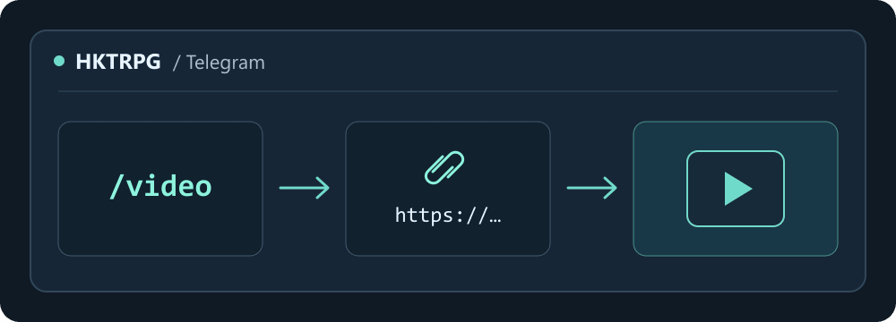

# Command Cheat Sheet

Use `/bothelp` on Discord, or type the text command `bothelp` to browse categories. [Discord Command Guide](../other-information/discord-ban-zhu-yi-shi-xiang.md)

| Command           | Content                                  |
| ----------------- | ---------------------------------------- |
| `bothelp`         | Overview                                 |
| `bothelp Base`    | Basic rolls, secret rolls, dice notation |
| `bothelp Dice`    | System dice list                         |
| `bothelp Tool`    | Tools                                    |
| `bothelp admin`   | Admin tools                              |
| `bothelp funny`   | Entertainment                            |
| `bothelp link`    | Invite links                             |
| `bothelp privacy` | Privacy                                  |

Also: [https://bothelp.hktrpg.com](https://bothelp.hktrpg.com)

### Base

| Command                | About                       | Docs                                                                          |
| ---------------------- | --------------------------- | ----------------------------------------------------------------------------- |
| `1d100` / `2d6+1`      | Basic rolls                 | [Basic Rolling](../trpg-features/kai-shi-jin-hang-trpg/ji-ben-zhi-tou.md)     |
| `dr` / `ddr` / `dddr`  | Secret rolls                | [Secret Rolls](../trpg-features/kai-shi-jin-hang-trpg/an-tou.md)              |
| `.drgm`                | Secret-roll GM list         | same                                                                          |
| `.char` / `.ch`        | Character sheets            | [Character Sheets](../trpg-features/kai-shi-jin-hang-trpg/jiao-se-ka.md)      |
| `.in` / `.init`        | Initiative                  | [Initiative](../trpg-features/kai-shi-jin-hang-trpg/xian-gong-biao.md)        |
| `.ra` / `.db` / `.cmd` | Custom dice, DB, saved cmds | TRPG section                                                                  |
| `.rr`                  | RPG Dice Roller             | [Western rolling](../trpg-features/rpg-dice-roller-mei-xi-zhi-tou-fang-fa.md) |

### Dice

| Command                         | System              | Docs                                                                             |
| ------------------------------- | ------------------- | -------------------------------------------------------------------------------- |
| `cc` / `.sc` / `.dp` / `.chase` | CoC                 | [CoC](../trpg-features/zhi-ding-trpg-xi-tong/coc-ke-su-lu-shen-hua.md)           |
| `.5e` etc.                      | D\&D 5e             | [DND 5e](../trpg-features/zhi-ding-trpg-xi-tong/dnd-5e.md)                       |
| `.pf2` etc.                     | PF2e                | [PF2e](../trpg-features/zhi-ding-trpg-xi-tong/pf2e.md)                           |
| `.4df`                          | Fate                | [Other systems](../trpg-features/zhi-ding-trpg-xi-tong/qi-ta-trpg-xi-tong.md)    |
| `.xwd`                          | WoD                 | same                                                                             |
| `.wn`                           | Witch Hunting Night | same                                                                             |
| `.kc`                           | Cat Onmyoji         | same                                                                             |
| `.bc`                           | BcDice              | [BcDice](../trpg-features/zhi-ding-trpg-xi-tong/bcdice-ri-xi-zhi-tou-fang-fa.md) |

Details: `bothelp Dice` or `command help` (e.g. `.4df help`).

### Tool / admin

| Command                 | About                               | Docs                                                                                  |
| ----------------------- | ----------------------------------- | ------------------------------------------------------------------------------------- |
| `.re`                   | Request roll buttons (Discord)      | [Request a Roll](../trpg-features/yao-qiu-zhi-tou.md)                                 |
| `.forward`              | Forward button results (Discord)    | [Button forwarding](../system-tools/discord-an-niu-zhuan-fa.md)                       |
| `.edit`                 | Edit HKTRPG / RP messages (Discord) | [Edit messages](../system-tools/discord-xiu-gai-jiu-xun-xi.md)                        |
| `.discord html` / `txt` | Export logs (Discord)               | [Chat log export](../system-tools/discord-bin-dao-liao-tian-ji-lu-shu-chu-gong-ju.md) |
| `.roleReact`            | Role reactions                      | [Role management](../system-tools/discord-shen-fen-zu-guan-li.md)                     |
| `.bk`                   | Feature toggles                     | [Feature toggles](../system-tools/gong-neng-kai-guan.md)                              |
| `.admin account`        | Web sheet account                   | [Character Sheets](../trpg-features/kai-shi-jin-hang-trpg/jiao-se-ka.md)              |
| `.patreon level`        | VIP level                           | [Development Support](development-support.md#vip-benefits-overview)                   |
| `.myname` / `.me`       | Roleplay speak                      | [Your Name](../trpg-features/ni-de-ming-zi-ban-yan-gong-neng.md)                      |

### funny

| Command          | About               | Docs                                                                         |
| ---------------- | ------------------- | ---------------------------------------------------------------------------- |
| Fortune / tarot  | Divination          | [Fortune](../entertainment-features/qu-wei-zhi-tou/zhan-bu.md)               |
| Daily jokes etc. | Daily fun           | [Daily](../entertainment-features/qu-wei-zhi-tou/mei-ri-yu-le.md)            |
| `.at` / `.cron`  | Scheduled messages  | [Schedule](../entertainment-features/ding-shi-fa-xun-gong-neng.md)           |
| `.level`         | XP / levels         | [Leveling](../entertainment-features/jing-yan-zhi-sheng-ji/)                 |
| `.ai` / `.ait`   | AI chat / translate | [AI](../entertainment-features/ai-fan-yi-dui-hua-gong-neng.md)               |
| `.st`            | StoryTeller         | [StoryTeller](../entertainment-features/storyteller-hu-dong-gu-shi-xi-tong/) |

#### Public Post Videos and Photos

In a chat with this feature enabled, send `.video <link>` or reply to a message containing a public post link with `.video`.

**Telegram mobile menu.** Tap `/video`, then reply to the bot’s prompt with the public URL. You can also send `/video <link>` or reply to the original post with `/video`.

You can use eligible public posts from Facebook, Instagram, Threads, TikTok, X, and Reddit. Public images on X and Reddit can be downloaded when the source provides them.


Use group or personal VIP in a group. DMs require personal VIP. Source videos can be up to 5 minutes and 30 MiB. Videos that need transcoding must be no longer than 90 seconds.


Telegram VIP levels 1, 2, 3, and 4+ can queue 3, 6, 9, and 12 waiting requests. The result includes the requester’s mention and source link. The bot attempts to remove a direct command after delivery if it has permission.

### Related

* [5-minute quick start](../#5-minute-quick-start)
* [Platform differences](../other-information/ping-tai-cha-yi-biao.md)
