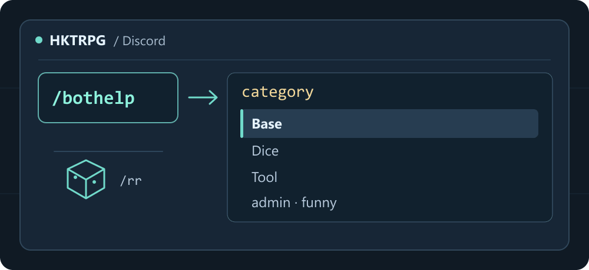

# Discord Command Guide

Type `/` in Discord, choose a command from **HKTRPG**, then fill in its options. Where the bot can read and reply to channel messages, you can also type `1d100` or `bothelp` directly.

_Illustration. Discord displays localized option labels._

## Common examples

Fill in options in Discord's command menu. For `/bothelp`, choose the basic rolls entry under `category`. Labels follow your Discord language.

| Action                       | What it does                  |
| ---------------------------- | ----------------------------- |
| `/bothelp`                   | Browse help categories        |
| `/rr` → `notation` → `1d100` | Roll a hundred-sided die      |
| `/dr` → `command` → `1d100`  | Roll privately                |
| `/char`                      | Open character tools          |
| `/lang`                      | Choose a reply language       |
| `/export` → `format` → HTML  | Export a channel you can read |

## Discord slash command index

The global Discord menu is grouped here by purpose. Availability can also depend on server and channel permissions.

Dice and systems

`/4df` · `/5ebuild` · `/bcdice` · `/broll` · `/build` · `/ca` · `/cc` · `/cc7bg` · `/ccb` · `/cccc` · `/ccdr` · `/ccpc` · `/ccrt` · `/ccsu` · `/chase` · `/d66` · `/d66n` · `/d66s` · `/dp` · `/dpg` · `/dr` · `/ddr` · `/dddr` · `/drgm` · `/hk` · `/int` · `/kc` · `/pf2` · `/poke` · `/rr` · `/sc` · `/uroll` · `/wd` · `/wn` · `/wndd` · `/wnmod`

Characters and sessions

`/ch` · `/char` · `/cmd` · `/in` · `/init` · `/initn` · `/mehistory` · `/mee` · `/myname` · `/re` · `/st` · `/token` · `/token2` · `/token3` · `/tokenupload`

Tools and administration

`/admin` · `/ai` · `/at` · `/bothelp` · `/chatroom` · `/code` · `/cron` · `/db` · `/dbp` · `/edit` · `/event` · `/export` · `/forward` · `/image` · `/imagesearch` · `/lang` · `/level` · `/patreon` · `/ra` · `/rap` · `/ras` · `/rolereact` · `/tran` · `/wiki`

Fun and media

`/choice` · `/digi` · `/me` · `/塔羅` · `/大十字塔羅` · `/排序` · `/時間塔羅` · `/每日` · `/每日塔羅` · `/立flag` · `/輪盤` · `/運勢` · `/隨機`

## If a slash command is missing

1. Check that HKTRPG is installed in the server. Type `/` in a channel and look for HKTRPG.
2. Ask a server admin to check application-command permissions for your role and channel, and the HKTRPG integration settings.
3. If the server used an old invite, an admin can reauthorize the existing installation from the [HKTRPG invite link](https://discord.hktrpg.com).

[Command Cheat Sheet](../getting-started/zhi-ling-su-cha-biao.md)
