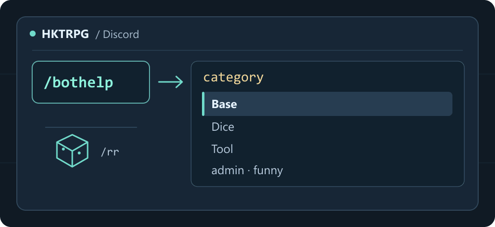

# Discord 指令入门

在 Discord 聊天框输入 `/`，选择 **HKTRPG** 的指令，再用菜单填写参数。频道允许机器人读取和回复消息时，你也可以直接输入 `1d100` 或 `bothelp`。

_操作示意。Discord 会按界面语言显示选项名称。_

## 常用示例

在指令菜单选择参数，例如 `/bothelp` 的 `category` 选择基本掷骰。选项名称会随 Discord 界面语言变化。

| 操作                           | 用途          |
| ---------------------------- | ----------- |
| `/bothelp`                   | 查看帮助分类      |
| `/rr` → `notation` → `1d100` | 掷一颗百面骰      |
| `/dr` → `command` → `1d100`  | 私下掷骰        |
| `/char`                      | 查看角色卡       |
| `/lang`                      | 选择语言        |
| `/export` → `format` → HTML  | 导出有权读取的频道记录 |

## Discord 斜线指令索引

以下按用途整理 Discord 全局菜单。各服务器或频道可以有不同的指令权限。

掷骰与系统

`/4df` · `/5ebuild` · `/bcdice` · `/broll` · `/build` · `/ca` · `/cc` · `/cc7bg` · `/ccb` · `/cccc` · `/ccdr` · `/ccpc` · `/ccrt` · `/ccsu` · `/chase` · `/d66` · `/d66n` · `/d66s` · `/dp` · `/dpg` · `/dr` · `/ddr` · `/dddr` · `/drgm` · `/hk` · `/int` · `/kc` · `/pf2` · `/poke` · `/rr` · `/sc` · `/uroll` · `/wd` · `/wn` · `/wndd` · `/wnmod`

角色与跑团

`/ch` · `/char` · `/cmd` · `/in` · `/init` · `/initn` · `/mehistory` · `/mee` · `/myname` · `/re` · `/st` · `/token` · `/token2` · `/token3` · `/tokenupload`

工具与管理

`/admin` · `/ai` · `/at` · `/bothelp` · `/chatroom` · `/code` · `/cron` · `/db` · `/dbp` · `/edit` · `/event` · `/export` · `/forward` · `/image` · `/imagesearch` · `/lang` · `/level` · `/patreon` · `/ra` · `/rap` · `/ras` · `/rolereact` · `/tran` · `/wiki`

娱乐与媒体

`/choice` · `/digi` · `/me` · `/塔羅` · `/大十字塔羅` · `/排序` · `/時間塔羅` · `/每日` · `/每日塔羅` · `/立flag` · `/輪盤` · `/運勢` · `/隨機`

## 看不到斜线指令

1. 先确认服务器安装了 HKTRPG，再在聊天框输入 `/` 并选择 HKTRPG。
2. 请管理员检查频道及身份组能否使用应用程序指令，以及服务器的集成设置是否限制了 HKTRPG。
3. 如果使用旧邀请链接加入，管理员可以用 [HKTRPG 邀请链接](https://discord.hktrpg.com) 重新授权现有服务器。

[指令速查表](../kai-shi-shi-yong/zhi-ling-su-cha-biao.md)
