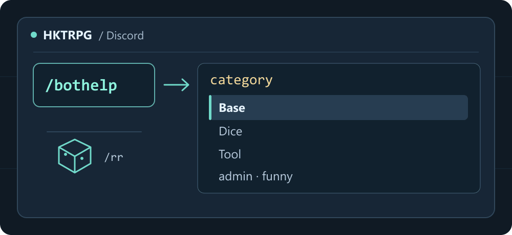

# Discord 指令入門

在 Discord 聊天欄輸入 `/`，揀 **HKTRPG** 嘅指令，再用選單填寫參數。頻道容許 Bot 讀取訊息同回覆時，你亦可以直接輸入 `1d100` 或 `bothelp`。

_操作示意。Discord 會按介面語言顯示選項名稱。_

## 常用例子

在指令選單揀參數，例如 `/bothelp` 嘅 `category` 揀「基本擲骰指令」。選項名稱會因 Discord 語言而不同。

| 操作                           | 用途          |
| ---------------------------- | ----------- |
| `/bothelp`                   | 看分類說明       |
| `/rr` → `notation` → `1d100` | 擲一顆百面骰      |
| `/dr` → `command` → `1d100`  | 私下擲骰        |
| `/char`                      | 查角色卡        |
| `/lang`                      | 選擇語言        |
| `/export` → `format` → HTML  | 匯出有權讀取的頻道紀錄 |

## Discord 斜線指令索引

以下按用途整理 Discord 全域選單。每個伺服器或頻道可以有不同的指令權限。

擲骰與系統

`/4df` · `/5ebuild` · `/bcdice` · `/broll` · `/build` · `/ca` · `/cc` · `/cc7bg` · `/ccb` · `/cccc` · `/ccdr` · `/ccpc` · `/ccrt` · `/ccsu` · `/chase` · `/d66` · `/d66n` · `/d66s` · `/dp` · `/dpg` · `/dr` · `/ddr` · `/dddr` · `/drgm` · `/hk` · `/int` · `/kc` · `/pf2` · `/poke` · `/rr` · `/sc` · `/uroll` · `/wd` · `/wn` · `/wndd` · `/wnmod`

角色與跑團

`/ch` · `/char` · `/cmd` · `/in` · `/init` · `/initn` · `/mehistory` · `/mee` · `/myname` · `/re` · `/st` · `/token` · `/token2` · `/token3` · `/tokenupload`

工具與管理

`/admin` · `/ai` · `/at` · `/bothelp` · `/chatroom` · `/code` · `/cron` · `/db` · `/dbp` · `/edit` · `/event` · `/export` · `/forward` · `/image` · `/imagesearch` · `/lang` · `/level` · `/patreon` · `/ra` · `/rap` · `/ras` · `/rolereact` · `/tran` · `/wiki`

娛樂與媒體

`/choice` · `/digi` · `/me` · `/塔羅` · `/大十字塔羅` · `/排序` · `/時間塔羅` · `/每日` · `/每日塔羅` · `/立flag` · `/輪盤` · `/運勢` · `/隨機`

## 找不到斜線指令

1. 先確認 HKTRPG 已安裝到伺服器，再在聊天欄輸入 `/` 並揀 HKTRPG。
2. 請管理員檢查該頻道及角色可否使用應用程式指令，以及伺服器的整合設定有冇限制 HKTRPG。
3. 如果用舊邀請連結加入，管理員可以用 [HKTRPG 邀請連結](https://discord.hktrpg.com) 重新授權現有伺服器。

[指令速查表](../kai-shi-shi-yong/zhi-ling-su-cha-biao.md)
